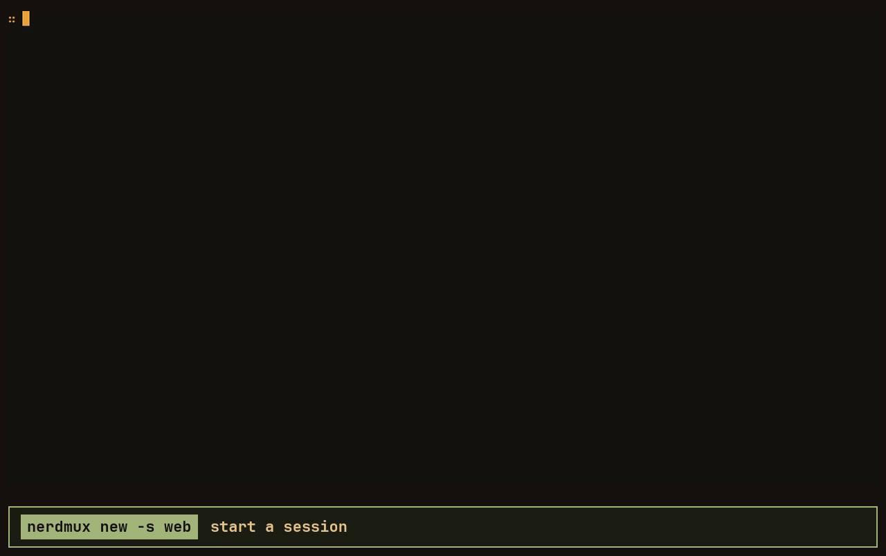

<p align="center">
<picture>
    <source media="(prefers-color-scheme: dark)" srcset="docs/logo/nerdmux-on-dark.svg">
    <source media="(prefers-color-scheme: light)" srcset="docs/logo/nerdmux-on-light.svg">
    
</picture>
</p>

<p align="center">Linux · macOS · <a href="LICENSE">MIT license</a></p>



A terminal multiplexer in one binary: windows (tabs), split panes, and sessions that outlive the terminal, and even a
crash or a reboot.

nerdmux is opinionated by design, with keys that work like a game's controls: movement always sits on the arrows (`Alt`
for panes, `Alt+Shift` for windows and sessions), and every action is the leader, `Alt+Space`, followed by the first
letter of what it does. No modes, nothing to memorize, and your shell keeps its own `Alt+letter` keys. It looks finished
out of the box, in warm charcoal and amber, and a settings panel changes anything on the spot.

## Install

Releases carry one static binary per platform: `x86_64-unknown-linux-musl`, `aarch64-unknown-linux-musl` and
`aarch64-apple-darwin` (Apple Silicon).

```sh
v=v0.1.1
t=x86_64-unknown-linux-musl     # or aarch64-unknown-linux-musl, aarch64-apple-darwin
curl -fLO https://github.com/Ndles/nerdmux/releases/download/$v/nerdmux-$v-$t.tar.gz
curl -fLO https://github.com/Ndles/nerdmux/releases/download/$v/nerdmux-$v-$t.tar.gz.sha256
sha256sum -c nerdmux-$v-$t.tar.gz.sha256
tar xzf nerdmux-$v-$t.tar.gz
install -m 755 nerdmux-$v-$t/nerdmux ~/.local/bin/nerdmux
```

On a Mac, check it with `shasum -a 256 -c` instead, and fetch it with `curl` as above: a copy downloaded in a browser
is quarantined by Gatekeeper.

## Build

Needs Rust 1.88 or newer.

```sh
cargo install --path .      # puts `nerdmux` in ~/.cargo/bin
scripts/setup.sh            # optional: launcher, icon, terminal window and font for your desktop
```

`setup.sh` works on Linux (GNOME, Hyprland, others) and macOS (new, not yet tested on a Mac), writes only under your
home directory, asks before anything outside nerdmux, and keeps a copy of any file it replaces; `--dry-run` shows what
it would do. Release archives include it.

## Getting started

```sh
nerdmux                # attach to your last session, or start the first one
```

| You want to                    | Press                                   |
|--------------------------------|-----------------------------------------|
| open a new pane                | `Alt+Enter`                             |
| move between panes             | `Alt+←` `Alt+↓` `Alt+↑` `Alt+→`         |
| go to the window left or right | `Alt+Shift+←` `Alt+Shift+→`             |
| go to the session above/below  | `Alt+Shift+↑` `Alt+Shift+↓`             |
| anything else                  | `Alt+Space`, then a key (a panel lists them) |
| open a new window (tab)        | `Alt+Space t`                           |
| manage sessions                | `Alt+Space s`                           |
| change settings                | `Alt+Space ,`                           |
| leave, keeping it all running  | `Alt+Space d`                           |

On GNOME, which keeps `Alt+Space` for itself, the leader is `Ctrl+Space` until you free it (see
[Things worth knowing](#things-worth-knowing)). `Alt+Space ?` shows every key, and `nerdmux keys` prints them. The mouse works too: click to focus, drag borders to
resize, drag to copy, scroll back with the wheel.

```sh
nerdmux new -s work            # start a named session
nerdmux new -s build -- make   # ...running a command instead of a shell
nerdmux ls                     # list sessions
nerdmux attach -t work         # attach by name (a unique prefix is enough)
nerdmux kill-server            # end everything
nerdmux action split-right     # run any action from a script or a pane
nerdmux new-window -n top --reuse -- btop  # open a window running btop, or go back to it
nerdmux attach --plain -t fleet  # no status bar or keys of its own, on a separate server: for use inside another program
```

### From a script

Programs, agents among them, can drive panes through the same socket. `-S PATH` keeps them on a server of their own,
away from your sessions.

```sh
nerdmux run -t work -n tests --timeout 300 -- make test   # output on stdout, its exit code as ours
nerdmux send -t work:tests --enter -- 'git status'        # type into a pane; --interrupt sends Ctrl+C first
nerdmux capture -t work -n 200                            # a pane's text, scrollback included
nerdmux panes -t work                                     # one line per pane, tab-separated
```

`run` opens a window for the command, leaves your active window alone, and answers when the command ends. It needs no
shell integration, because the command is the window's program. It exits with the command's code, 124 if the command
outlives `--timeout` and keeps running (the message names its pane), and 125 if nerdmux itself failed.

A target is `SESSION` or `SESSION:WINDOW`, the window by name or by number from 1, or use `-p PANE` for a pane id.
Inside nerdmux the default is the current pane. The columns of `panes` are session, window number, window name, pane,
active (1 or 0), columns, rows, directory and program.

### After a crash or reboot

nerdmux keeps a snapshot of its sessions in `~/.local/state/nerdmux/`, readable only by you, and deletes it when it ends
cleanly. If it did not, the next `nerdmux` offers the saved sessions back: each pane returns in its directory with its
old text. On Linux, editors, pagers and monitors (nvim, less, btop, lazygit, ...) start again; anything else, such as a
dev server or `ssh`, is typed at the prompt for you to run with Enter. Environment variables are not saved, since they
may hold secrets.

## Configuration

`~/.config/nerdmux/config.toml`; `nerdmux config` prints a commented template, and the settings panel (`Alt+Space ,`)
edits the file for you, keeping your comments. Everything is optional:

```toml
prefix = "ctrl+a"           # the leader
status = "top"              # "top", "bottom" or "off"
padding = 1                 # empty columns beside the panes; 0 if your terminal pads already
padding_rows = 1            # empty rows on the edge away from the status bar
restore_programs = ["k9s"]  # also started again after a crash

[theme]
accent = "#FF8C00"
own_palette = false         # keep your terminal's colors inside panes

[keys.direct]               # chords
"alt+enter" = "none"        # "none" removes a default binding

[keys.prefix]               # keys after the leader
"e" = "split-right"
```

To switch the whole look, start from a theme: `base = "synthwave"` under `[theme]` picks the built-in neon one, and any
color set next to it still wins. Your own themes go in `~/.config/nerdmux/themes/<name>.toml`;
[themes/synthwave.toml](themes/synthwave.toml) sets every color nerdmux knows, including the gradients `status_bg` and
`frame` can take, and makes a good starting point.

A theme for every Nërd tool at once (nerdmux, nerdfleet, ...) goes in `~/.config/nerd-theme.toml`: the same `[theme]`
table, `base` included. nerdmux puts its own `[theme]` on top, so a color set there changes nerdmux alone. The settings
panel changes the shared theme; `Tab` switches its Theme section to nerdmux's own, and the shared view shows any color
nerdmux keeps for itself. Edits to the file, from anywhere, show in running tools within a second.

## Things worth knowing

- **Best setup.** nerdmux looks as intended in a fast terminal with true color and the kitty keyboard protocol, such
  as Alacritty (what Omarchy ships), kitty, Ghostty or WezTerm, with a [Nerd Font](https://www.nerdfonts.com) such as
  JetBrainsMono Nerd Font for the icons nvim, lazygit and others draw, in a window without a title bar.
  `scripts/setup.sh` sets that up.
- **Alt on macOS.** Terminal.app and iTerm2 keep `Alt` (Option) to themselves until "Use Option as Meta key" is turned
  on. Or pick a leader without it, such as `prefix = "ctrl+a"`.
- **Alt+Space on GNOME.** `Alt+Space` is the intended leader: it sits under the thumb and no shell or editor uses it.
  GNOME (Ubuntu, Fedora) keeps it for its window menu, though, and takes it before any terminal sees it. nerdmux does
  not change desktop settings; when you attach from a GNOME desktop that holds the key, it uses `Ctrl+Space` instead
  and says so in the status bar. To get `Alt+Space` back, free it in GNOME (the window menu stays on a right click of
  the title bar), and nerdmux returns to it the next time you attach:

  ```sh
  gsettings set org.gnome.desktop.wm.keybindings activate-window-menu "[]"     # undo: gsettings reset ...
  ```

  A `prefix` in your config always wins, and nerdmux then only warns if GNOME holds it.
- **Chords that collide.** `Alt+arrows` jump by word in some shell setups. Unbind what you miss with
  `"alt+left" = "none"`.
- **The prompt.** Shells in panes (bash, zsh, fish) load your own startup files, aliases and all, then get a `∷` prompt
  in the accent color, since the status bar already shows the directory and branch. Your dotfiles are not touched:
  bash gets an `--rcfile` that reads `~/.bashrc` first, zsh a `ZDOTDIR` that hands back to yours, fish an
  `--init-command`. `prompt_mark` picks another mark (`∷` is a math sign, so fonts center it on the line, and nearly
  every monospace font has it), and `prompt = false` keeps your own prompt.
- **The title.** nerdmux titles the terminal `session › program`. Titles a shell sets for itself at its prompt (Ubuntu's
  `user@host: dir`) are ignored; a program's own, such as an editor's, shows while it runs. Variables that name the
  outer terminal (`VTE_VERSION`, `GNOME_TERMINAL_SCREEN`, `KITTY_WINDOW_ID`, ...) are kept out of panes, so its shell
  integration does not load inside them.
- **Padding.** nerdmux keeps one empty column on either side of the panes and one empty row on the edge away from the
  status bar, so text never touches the window edge in terminals without padding of their own, such as GNOME Terminal.
  With several panes, the outline around the focused one sits in that space, so text stays put when you split.
  Where the terminal already pads (Omarchy's Alacritty), `padding = 0` and `padding_rows = 0` give the space back.
- **No title bar.** A program inside a terminal cannot hide the terminal's title bar or scrollbar, so nerdmux leaves
  your terminal's settings alone. GNOME Terminal draws its header in every mode but full screen (F11); Alacritty
  (`window.decorations = "None"`), kitty (`hide_window_decorations yes`) and Ghostty (`window-decoration = none`) can
  drop it, and `setup.sh` gives nerdmux a launcher that opens it that way, 200×80 cells large (`--size` picks another
  size, `--maximized` fills the screen). GNOME still moves the window with Super+drag, resizes it with Alt+F8 or
  Super+middle-drag, and maximizes and restores it with Super+Up / Super+Down. A terminal installed as a snap starts
  programs inside the snap's environment (its own GIO modules, graphics drivers and cache); nerdmux leaves that behind,
  so the panes, and its check for GNOME's Alt+Space, see the system as it is.
- **Selecting text.** Hold `Shift` to use your terminal's own selection instead of nerdmux's.
- **Nesting.** Starting nerdmux inside nerdmux is refused; use the session manager (`Alt+Space s`) to change session.

## How it compares

tmux and Zellij are both excellent; nerdmux makes different choices.

- **Keys.** tmux puts everything behind a prefix and single symbols to memorize (`%`, `"`, `&`); Zellij uses modes and
  `Ctrl` chords. nerdmux moves with the arrows, runs actions with the leader and a first letter, and leaves
  `Ctrl+letter` and `Alt+letter` to your shell and editor.
- **Setup.** It is ready without a config file, and the settings panel covers what you would otherwise look up.
- **Scope.** One small binary focused on panes, windows and sessions. Instead of a plugin system, any action can be
  scripted with `nerdmux action`.

## License

MIT © 2026 Pavel Kuksa. See [LICENSE](LICENSE).
